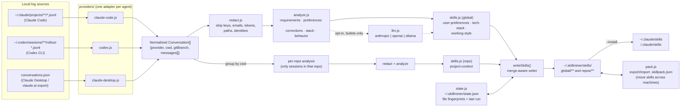
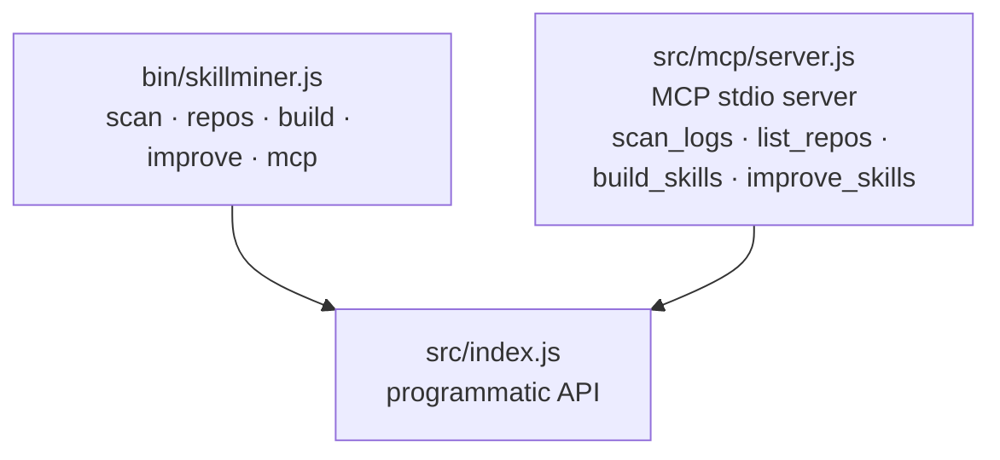

# skillminer — Architecture

## The idea

Agent sessions are a goldmine of durable context: what you require, what you reject, what stack you live in, how you like to be talked to. That context is trapped in provider-specific log formats scattered across your machine. skillminer is a local pipeline that lifts it out, scrubs it, and condenses it into plain-markdown skills any agent can load.

## Pipeline



Two front doors drive the same pipeline:



## Stage by stage

### 1. Providers (`src/providers/`)

A provider is a module with four exports:

```js
export const name = "my-agent";
export function defaultRoot() { /* where this agent keeps logs */ }
export function detect(root) { /* is it present? */ }
export function load({ root }) { /* → Conversation[] */ }
```

| Provider | Source | Notes |
|---|---|---|
| `claude-code` | `~/.claude/projects/<slug>/<session>.jsonl` | Keeps only human-typed prompts (`origin.kind === "human"`) and assistant text; drops tool traffic, sidechains, system-reminders. Captures `cwd` + `gitBranch` per session. |
| `codex` | `~/.codex/sessions/YYYY/MM/DD/rollout-*.jsonl` | Handles the `response_item` envelope and older flat records; strips `<environment_context>` wrapper turns. `cwd` comes from `session_meta`. |
| `claude-desktop` | `conversations.json` from the official data export | Chat content is server-side, so the export is the reliable local source; `--import <path>` or auto-detected in `~/Downloads`. |

**Adding a provider** (Gemini CLI, Aider, Cursor, …) = one new file implementing those four exports + one line in `providers/index.js`. Nothing downstream changes, because everything downstream consumes the normalized model.

### 2. Normalized model (`core/model.js`)

```
Conversation { id, provider, title, cwd, gitBranch, startedAt, endedAt, sourceFile, messages[] }
Message      { role: "user" | "assistant", text, ts }
```

Only plain text survives normalization — tool calls, attachments, file snapshots and harness noise are dropped at the provider boundary.

### 3. Redaction (`core/redact.js`) — runs *before* analysis

Pattern-based scrubbing of: Anthropic/OpenAI/GitHub/Slack/AWS/Google keys, JWTs, bearer tokens, `password=`/`secret=` assignments, credentialed URLs and token query params, emails, phone numbers, card-like numbers, IPs, PEM private-key blocks. Home paths become `~`; the OS username becomes `[USER]`. Lines that still look sensitive afterwards (SSNs, bank details, …) are discarded entirely by the analyzer.

The rule for generated skills: **requirements, never data.**

### 4. Analysis (`core/analyze.js`) — pure heuristics, fully offline

From **user messages only**:

- **Requirements** — sentences matching imperative-constraint phrasing (*make sure, must, always, never, don't, needs to…*).
- **Preferences** — *I prefer, instead of, rather than, stick with…*
- **Corrections** — messages that open with pushback (*no, actually, that's wrong, revert…*). The strongest signal of what matters to the user.
- **Stack** — frequency of ~90 technology keywords across all messages.
- **Behavior** — message counts/lengths, active hours, and ratios that become working-style traits (plans-first, tests-expected, explain-why, link-sharing, terse vs detailed prompts).

Guards against false positives: messages over 4 000 chars are treated as pasted documents (mined for stack signals, not sentences); markdown-structural and code-like lines are rejected; everything is deduplicated on a normalized key.

### 5. Skill building (`core/skills.js`)

Emits the open `SKILL.md` convention — YAML frontmatter (`name`, `description`) + markdown body — because it is what Claude Code loads natively and is plain enough for any other agent to ingest as context. Layout:

```
<out>/global/user-preferences/SKILL.md
<out>/global/tech-stack/SKILL.md
<out>/global/working-style/SKILL.md
<out>/repos/<repo-slug>/project-context/SKILL.md
```

**Repo scoping:** conversations are grouped by their recorded `cwd`; a repo's skill is built *only* from sessions that ran inside that repo, so cross-project context never leaks. Repos yielding no durable requirements are skipped, not stubbed.

### 6. Merge-aware writing — how `improve` works

`writeSkills()` never blind-overwrites. If a `SKILL.md` exists, old and new are merged **per section, per bullet**: sections are split on headings, bullets deduplicated on a normalized key, and old bullets absent from the new build — including ones a human added by hand — are carried over. So skills accumulate and refine; they don't churn.

`~/.skillminer/state.json` records a `size:mtime` fingerprint per source file. `improve` diffs against it to report exactly how many session files are new or changed since the last run.

### 7. Optional LLM polish (`core/llm.js`)

Strictly additive and off by default. When `SKILLMINER_LLM` is set (`anthropic` | `openai` | `ollama`), the already-extracted, already-redacted bullets — nothing else — are sent for a rewrite into crisper instructions. The `ollama` path (or `SKILLMINER_LLM_BASE_URL` pointed at any OpenAI-compatible server) keeps even that step fully local. Provider-agnostic by design: extraction never depends on any model.

### 8. Skill packs — export/import (`core/pack.js`)

Skills travel between machines as a single `.skillpack.json`:

```json
{ "format": "skillminer-pack", "version": 1, "exportedAt": "...",
  "skills": [ { "dir": "global/user-preferences", "content": "<SKILL.md text>" } ] }
```

`export` walks the skills directory and bundles every `SKILL.md` (already redacted by construction, so the pack is safe to move or share). `import` is **read-and-append**: new skills are added; existing ones go through the same section/bullet merger as `improve`, so local knowledge and hand edits survive and re-importing is idempotent. Pack entries are validated against path escape (`../`, absolute paths) before writing.

### 9. MCP server (`src/mcp/server.js`)

A zero-dependency implementation of the MCP stdio transport (newline-delimited JSON-RPC 2.0) covering `initialize`, `tools/list`, `tools/call`, `ping`. It exposes the same programmatic API the CLI uses — `scan_logs`, `list_repos`, `build_skills`, `improve_skills`, `export_skills`, `import_skills` — so any MCP client can scan, build, improve, or move skills between machines mid-session.

## Design decisions

- **Zero runtime dependencies.** Parsers, redaction, analysis, and the MCP transport are hand-rolled on Node built-ins. Nothing to audit in `node_modules` for a tool that reads your entire agent history.
- **Heuristics first, LLM optional.** The default path works offline, on any machine, with no account — and is deterministic, which makes privacy auditable.
- **Normalize early.** Provider quirks stop at the adapter boundary; one model feeds everything else.
- **Merge, don't regenerate.** Skills are living documents users will edit; clobbering hand edits would make the tool untrustworthy.
- **Scope by `cwd`.** The session's working directory is the most reliable cross-provider signal of "which project was this about".

## Repository layout

```
skillminer/
├── bin/skillminer.js        CLI entry
├── src/
│   ├── index.js             programmatic API (build/improve/scan/listRepos)
│   ├── providers/           one adapter per agent + registry
│   ├── core/
│   │   ├── model.js         normalized Conversation/Message
│   │   ├── redact.js        privacy layer
│   │   ├── analyze.js       heuristic miner
│   │   ├── skills.js        SKILL.md builder + section/bullet merger
│   │   ├── state.js         run-state fingerprints (~/.skillminer/state.json)
│   │   ├── pack.js          portable .skillpack.json export/import
│   │   └── llm.js           optional polish pass
│   └── mcp/server.js        MCP stdio server
├── test/                    node:test suite + fixtures
└── docs/ARCHITECTURE.md     this file
```
